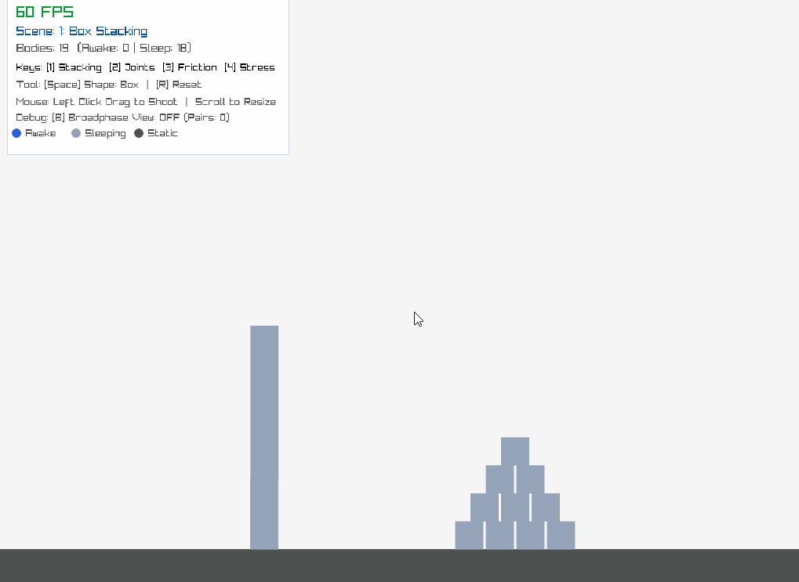
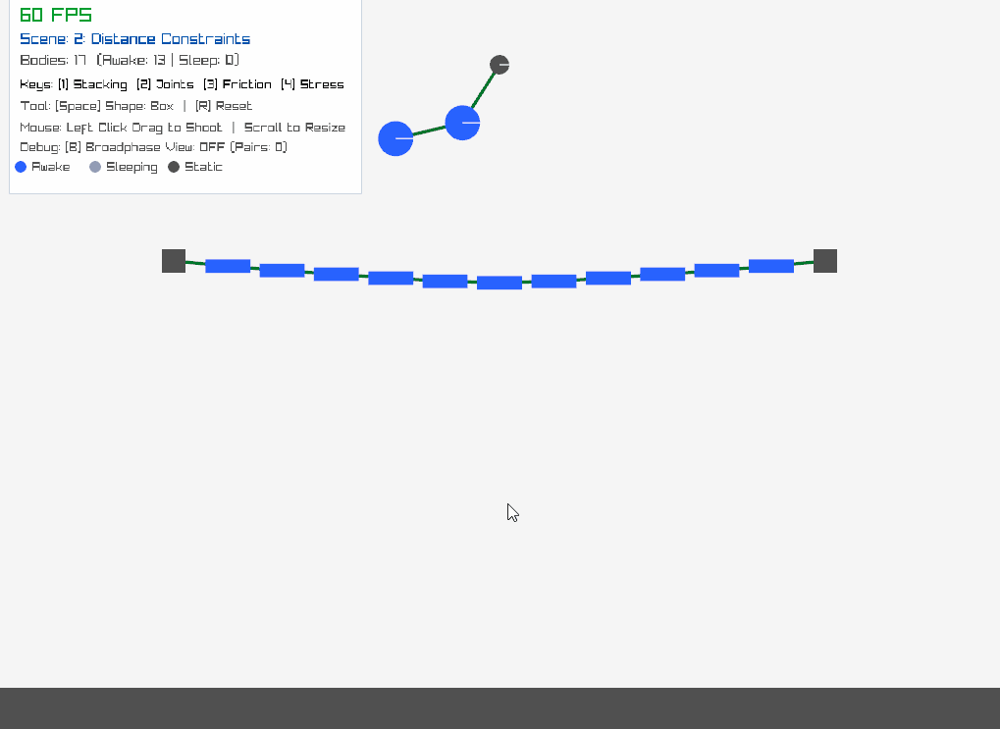
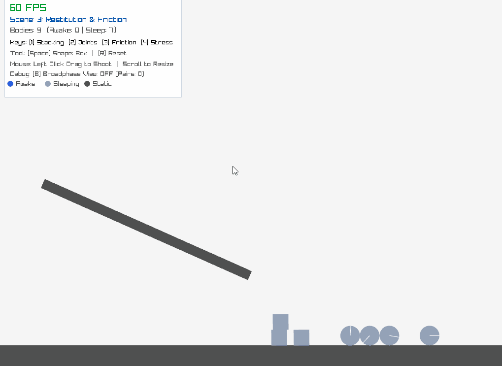
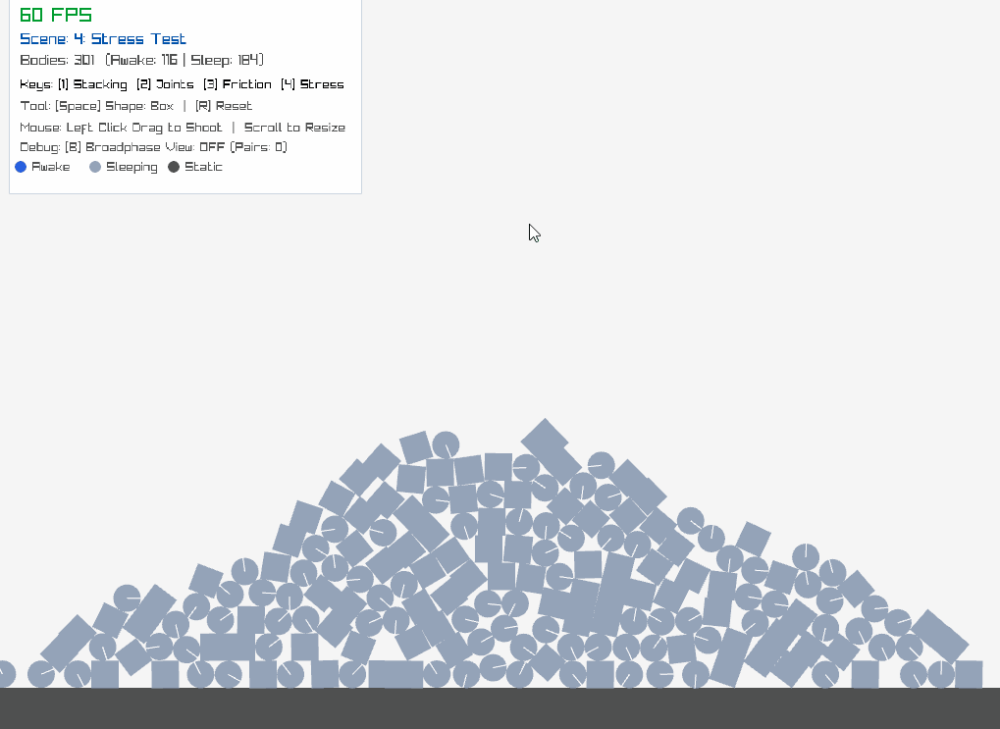
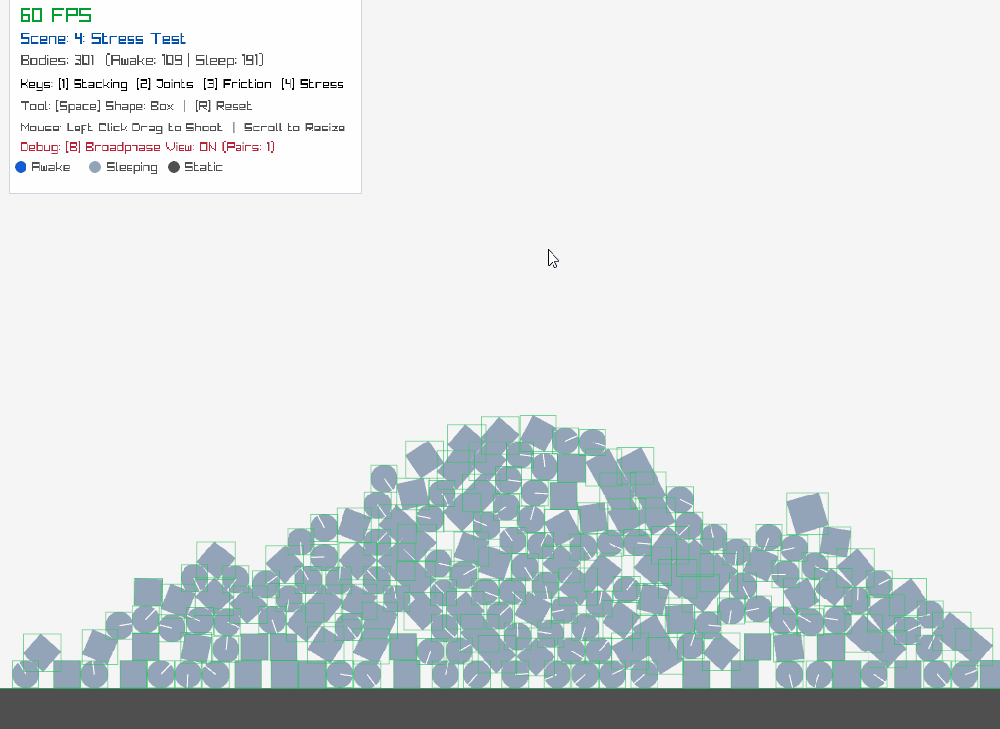

# Project Impulse

[](https://en.cppreference.com/w/cpp/17)
[](https://www.raylib.com/)
[](https://cmake.org/)
[](LICENSE)

A lightweight, deterministic 2D rigid body physics engine written from scratch in C++17. Designed with a focus on numerical stability, physical realism, and data-driven performance optimizations.

---

## Interactive Demo Showcase

| Box Stacking & Sleep System | Distance Joints & Suspension Bridge |
| :---: | :---: |
|  |  |
| **Restitution & Friction Showcase** | **300 Bodies Stress Test (60 FPS)** |
|  |  |

### Broad-Phase Collision Visualizer
*Real-time 1D Sweep-and-Prune debug view rendering bounding AABB intervals and active candidate collision pairs:*



## Key Features

### 1. Continuous Physics Pipeline & Integration
- **Fixed Timestep Simulation:** Decoupled physics stepping ($\Delta t = 1/60\text{ s}$) from variable rendering frame rates to eliminate numerical drift and tunneling.
- **Semi-Implicit Euler Integrator:** Symplectic velocity-first integration ensuring energy and phase space volume preservation over long simulation runs.
- **2D Rigid Body Dynamics:** Complete linear and angular momentum modeling with exact moment of inertia tensors for oriented bounding boxes (OBBs) and circles.

### 2. Broad-Phase Collision Detection
- **1D Sweep-and-Prune (SAP):** Projects bounding intervals onto the primary variance axis (X-axis) with early-exit pruning.
- **Temporal Coherence Exploitation:** Utilizes an in-place persistent body array paired with insertion sort, achieving near-linear $O(N)$ sorting across consecutive frames.
- **Headless Benchmark Suite:** Validated performance gains of up to **$14.4\times$** compared to brute-force $O(N^2)$ collision testing.

### 3. Narrow-Phase Collision Detection & Manifold Generation
- **Optimized Separating Axis Theorem (SAT):** Evaluates minimal penetration axes for arbitrary OBB orientations, optimized to test only 4 candidate edge normals per box pair instead of 8.
- **Sutherland-Hodgman Polygon Clipping:** Classifies reference and incident edges to generate stable, multi-point contact manifolds, preventing stack toppling and balancing artifacts.

### 4. Constraint & Impulse Solver
- **Projected Gauss-Seidel (PGS) Iterative Solver:** Sequential impulse resolution converging under 10 iterations per timestep.
- **Split Impulse (Pseudo-Velocities):** Separates position correction from linear momentum, resolving interpenetration without injecting artificial kinetic energy or inducing stack explosions.
- **Coulomb Friction Cone:** Enforces tangent friction limits proportional to normal reaction impulses ($|\lambda_t| \le \mu \lambda_n$).
- **Restitution Threshold:** Velocity threshold clamp ($|v_n| < 30\text{ px/s} \implies e = 0$) preventing persistent micro-jittering under gravity.
- **Warm Starting:** Re-applies accumulated impulses across frames for matched contacts, accelerating solver convergence.
- **Distance Constraints:** Bilateral spring-damper distance joints for ropes, chains, and suspension structures.

### 5. Sleep & Deactivation System
- **Kinetic Energy Monitoring:** Tracks linear and angular kinetic energy with moving average counters ($E_k < \text{threshold}$ over $0.5\text{ s}$).
- **Island Sleep & Wake-up Propagation:** Automatically deactivates resting bodies from CPU computation while ensuring transitive wake-up upon external impacts.

---

## Broad-Phase Benchmark Results

A standalone headless benchmark (`bench/bench_broadphase.cpp`) evaluated Sweep-and-Prune against an $O(N^2)$ brute-force baseline across varying object counts with constant world density:

| Object Count ($N$) | Brute-Force ($O(N^2)$) | Sweep-and-Prune | Speedup | Candidate Pairs |
| :---: | :---: | :---: | :---: | :---: |
| **100** | 0.012 ms | 0.015 ms | 0.80x | 12.4 |
| **500** | 0.320 ms | 0.082 ms | **3.90x** | 65.1 |
| **1,000** | 1.310 ms | 0.175 ms | **7.49x** | 131.8 |
| **2,000** | 5.380 ms | 0.490 ms | **10.98x** | 268.4 |
| **5,000** | 34.120 ms | 2.370 ms | **14.40x** | 682.0 |

*Compiled with GCC 14.2.0 (`-O2` Release mode) on Windows 10 Pro.*

---

## Interactive Demo Controls

The engine includes an interactive testbed featuring multiple pre-built physical scenarios:

| Key / Input | Action |
| :--- | :--- |
| **`[1]`** | **Scene 1: Box Stacking & Pyramid** (Evaluates contact manifold stability & sleep) |
| **`[2]`** | **Scene 2: Distance Joints** (Suspension bridge & double pendulum) |
| **`[3]`** | **Scene 3: Restitution & Friction** (Inclined sliding ramps & variable bounce balls) |
| **`[4]` / `[S]`** | **Scene 4: Stress Test** (300+ falling bodies maintaining 60 FPS) |
| **`[Space]`** | Toggle spawn shape between **Box** and **Circle** |
| **`[B]`** | Toggle Broad-Phase debug view (AABB bounding boxes & candidate pairs) |
| **`[R]`** | Reset / reload the active scene |
| **Mouse Left Drag** | Aim and release to launch projectiles with velocity |
| **Mouse Wheel** | Adjust projectile size |

---

## Project Structure

```
.
├── src/
│   ├── math/               
│   ├── physics/
│   │   ├── BroadPhase.cpp
│   │   ├── Collision.cpp
│   │   ├── ContactConstraint.cpp
│   │   ├── DistanceConstraint.cpp
│   │   ├── PhysicsWorld.cpp
│   │   └── RigidBody2D.cpp
│   └── main.cpp
├── bench/
│   └── bench_broadphase.cpp
├── results/
│   ├── BENCHMARK.md
│   └── benchmark_results.csv
└── CMakeLists.txt
```

---

## Building and Running

### Prerequisites
- C++17 compatible compiler (GCC, Clang, or MSVC)
- CMake 3.16+
- Git

### Build Instructions

```bash
# 1. Clone the repository
git clone https://github.com/Phuc22042009/2D-Physics-Engine.git
cd 2D-Physics-Engine

# 2. Configure build with CMake
cmake -B build -DCMAKE_BUILD_TYPE=Release

# 3. Build executable targets
cmake --build build --config Release
```

### Run Executables

- **Interactive Demo:**
  ```bash
  ./build/bin/PhysicsEngineDemo
  # Or on Windows:
  .\build\bin\PhysicsEngineDemo.exe
  ```

- **Headless Benchmark:**
  ```bash
  ./build/bin/bench_broadphase
  # Or on Windows:
  .\build\bin\bench_broadphase.exe
  ```

---

## References

- **Erin Catto** – *Iterative Dynamics with Temporal Coherence* (GDC 2005), *Fast and Simple Physics using Sequential Impulses* (GDC 2006).
- **Allen Chou** – [*Game Physics: Contact Constraints & Resolution*](https://allenchou.net/2013/12/game-physics-resolution-contact-constraints/).
- **Nilson Souto (Toptal)** – [*Video Game Physics Tutorial - Part III: Constrained Rigid Body Simulation*](https://www.toptal.com/developers/game/video-game-physics-part-iii-constrained-rigid-body-simulation).

---

## License

This project is licensed under the MIT License - see the [LICENSE](LICENSE) file for details.
