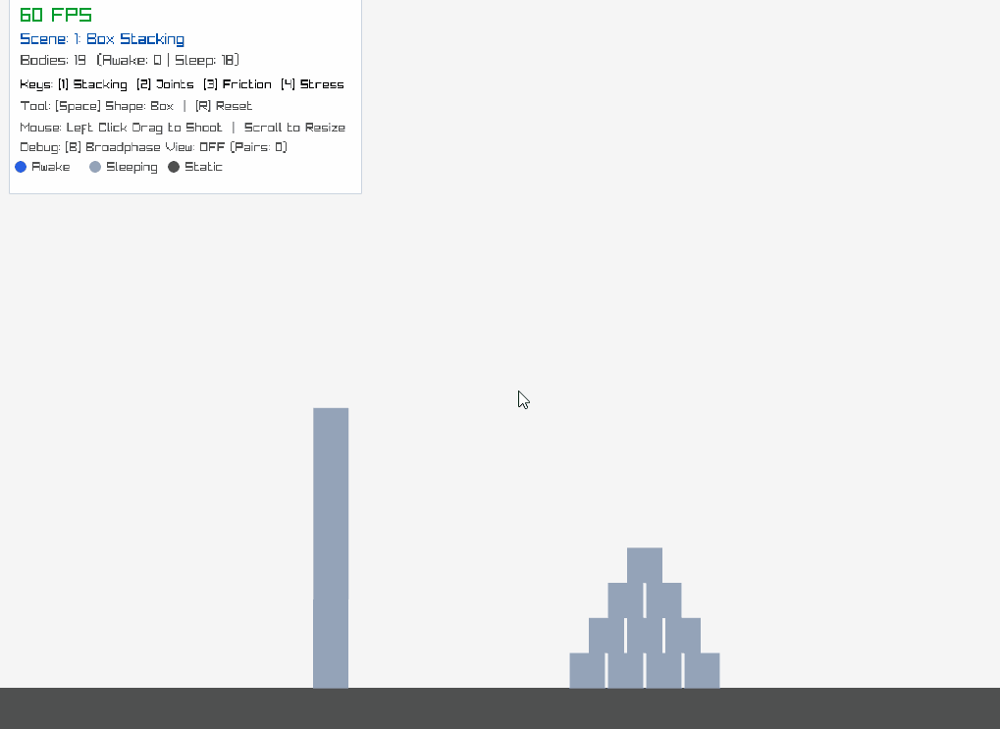
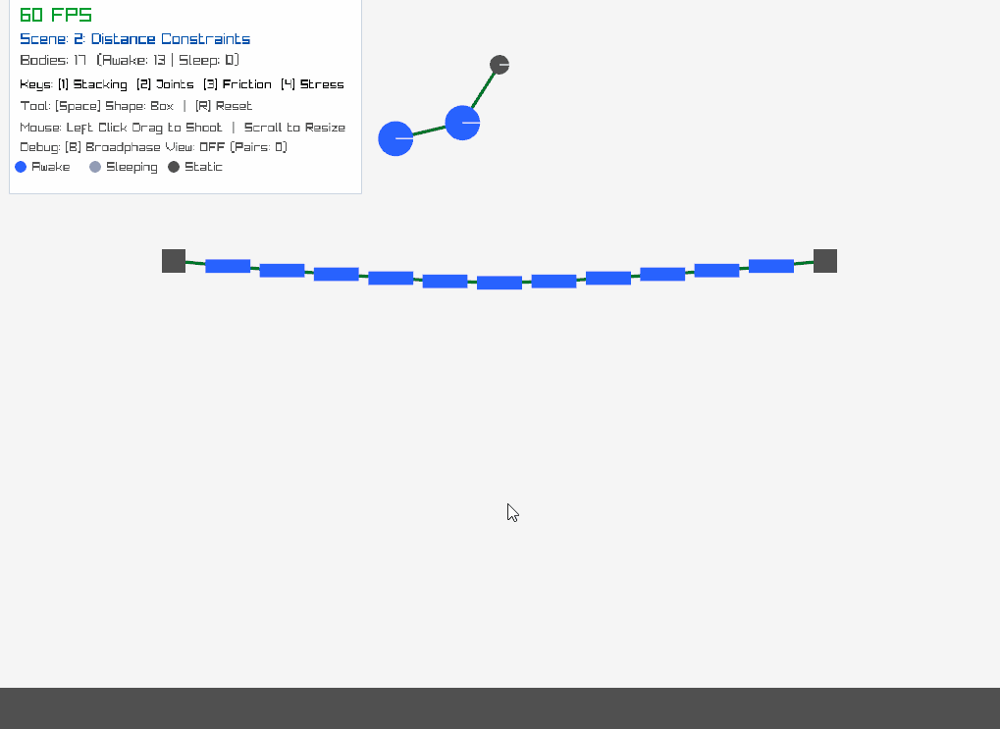
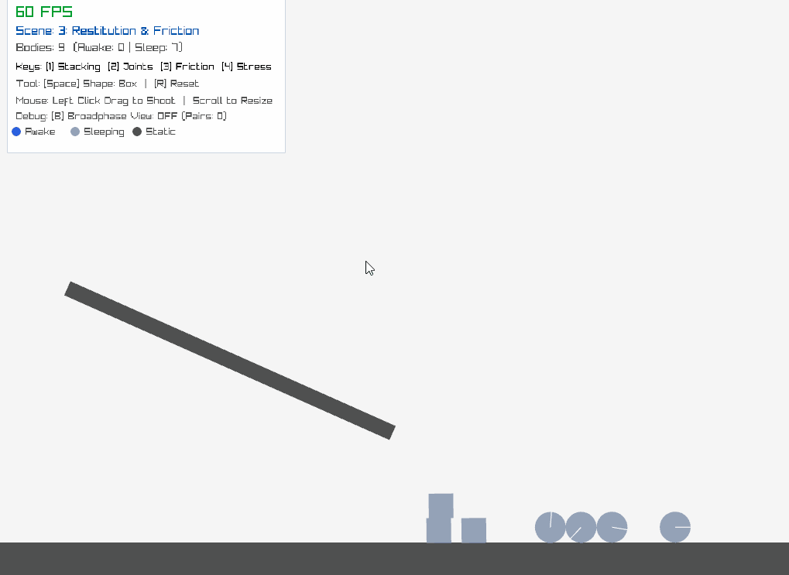
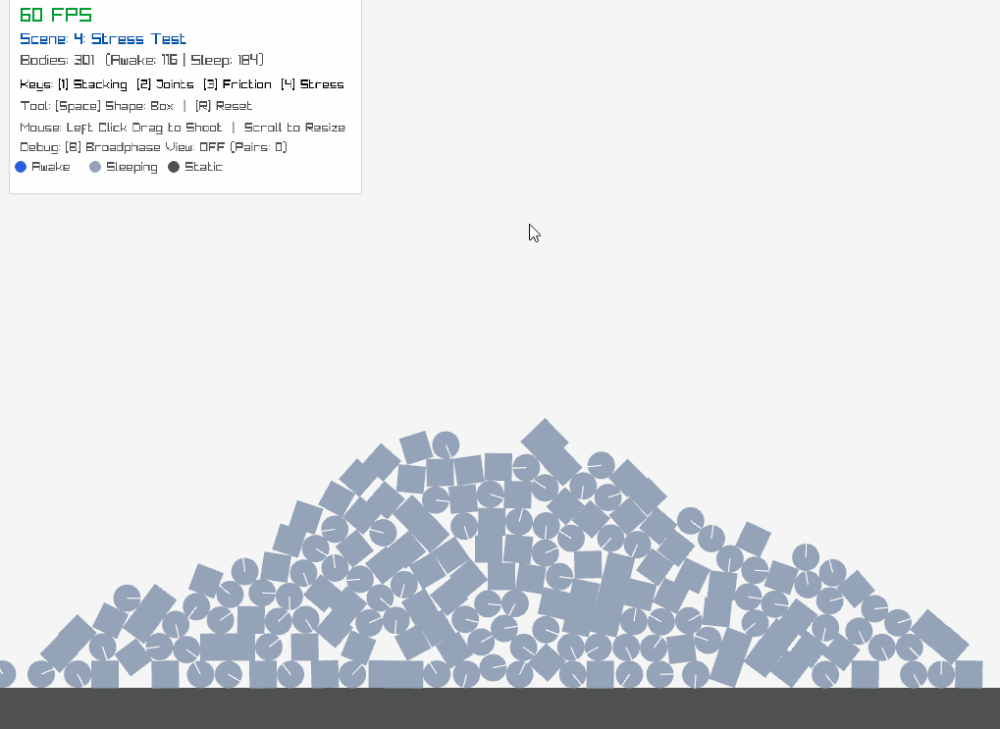
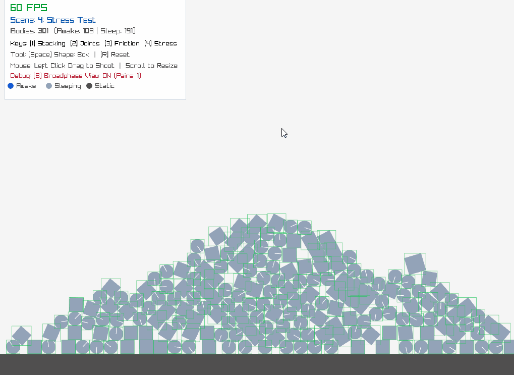

# Project Impulse

[](https://en.cppreference.com/w/cpp/17)
[](https://www.raylib.com/)
[](https://cmake.org/)
[](LICENSE)

A lightweight, deterministic 2D rigid body physics engine written from scratch in C++17. Designed with a focus on numerical stability, physical realism, and data-driven performance optimizations.

---

## Interactive Demo Showcase

| Box Stacking & Sleep System | Distance Joints & Suspension Bridge |
| :---: | :---: |
|  |  |
| **Restitution & Friction Showcase** | **300 Bodies Stress Test (60 FPS)** |
|  |  |

### Broad-Phase Collision Visualizer
*Real-time 1D Sweep-and-Prune debug view rendering bounding AABB intervals and active candidate collision pairs:*



---

## Key Features

### 1. Continuous Physics Pipeline & Integration
- **Fixed Timestep Simulation:** Decoupled physics stepping ($`\Delta t = 1/60\text{ s}`$) from variable rendering frame rates via an accumulator loop, significantly mitigating numerical drift and integration divergence compared to variable $`\Delta t`$.
- **Semi-Implicit Euler Integrator:** Symplectic velocity-first integration preserving phase space volume, combined with tuned velocity damping factors to ensure stable settling without energy drift during sustained stacking.
- **2D Rigid Body Dynamics:** Full linear and angular momentum formulation with exact moment of inertia tensors for oriented bounding boxes (OBBs) and circles.

### 2. Broad-Phase Collision Detection
- **1D Sweep-and-Prune (SAP):** Projects bounding intervals onto the persistent X-axis with early-exit pruning.
- **Temporal Coherence Exploitation:** Utilizes an in-place persistent body array paired with insertion sort, achieving near-linear $`O(N)`$ sorting across consecutive frames under uniform distributions.
- **Headless Benchmark Suite:** Validated performance gains of up to $`\mathbf{14.4\times \sim 67\times}`$ compared to brute-force $`O(N^2)`$ baseline testing.

### 3. Narrow-Phase Collision Detection & Manifold Generation
- **Optimized Separating Axis Theorem (SAT):** Evaluates minimal penetration axes for arbitrary OBB orientations, testing 4 candidate edge normals per box pair.
- **Sutherland-Hodgman Polygon Clipping:** Classifies reference and incident edges to generate stable, 2-point contact manifolds with robust single-point geometric fallbacks, preventing stack toppling.

### 4. Constraint & Impulse Solver
- **Projected Gauss-Seidel (PGS) Iterative Solver:** Sequential impulse resolution converging under 10 iterations per timestep.
- **Split Impulse (Pseudo-Velocities):** Separates position correction from linear momentum, resolving interpenetration without injecting artificial kinetic energy or inducing stack explosions.
- **Coulomb Friction Cone:** Enforces tangent friction limits proportional to normal reaction impulses ($`|\lambda_t| \le \mu \lambda_n`$).
- **Restitution Threshold:** Velocity threshold clamp ($`|v_n| < 30\text{ px/s} \implies e = 0`$) preventing persistent micro-jittering under gravity.
- **Warm Starting:** Re-applies accumulated impulses across frames for matched contacts, accelerating solver convergence.
- **Distance Constraints:** Bilateral spring-damper distance joints for ropes, chains, and suspension structures.

### 5. Sleep & Deactivation System
- **Kinetic Energy Monitoring:** Tracks linear and angular kinetic energy ($`E_k < \text{threshold}`$ over $`0.5\text{ s}`$).
- **Island Sleep & Wake-up Propagation:** Automatically deactivates resting bodies from CPU computation while ensuring transitive wake-up upon external impacts.

---

## Broad-Phase Benchmark Results

A standalone headless benchmark (`bench/bench_broadphase.cpp`) evaluated Sweep-and-Prune against an $`O(N^2)`$ brute-force baseline across varying object counts.

### Scenario A: Uniform Constant-Density Arena
Spatial density is held constant across all $`N`$ by scaling world area proportionally ($`\text{Area} = N \times 16,000\text{ px}^2`$). Objects have randomized dimensions ($`R \in [8, 24]\text{ px}`$), velocities, and bounce off arena boundaries.

| Object Count ($`N`$) | Brute-Force ($`O(N^2)`$) | Sweep-and-Prune (InsertionSort) | Sweep-and-Prune (std::sort) | Speedup vs. Brute-Force | Average Candidate Pairs |
| :---: | :---: | :---: | :---: | :---: | :---: |
| **100** | 0.037 ms | **0.007 ms** | 0.009 ms | **5.4x** | 18.7 |
| **500** | 0.647 ms | **0.041 ms** | 0.056 ms | **15.8x** | 90.7 |
| **1,000** | 2.194 ms | **0.087 ms** | 0.120 ms | **25.4x** | 173.8 |
| **2,000** | 8.272 ms | **0.237 ms** | 0.328 ms | **34.9x** | 345.9 |
| **5,000** | 48.077 ms | **0.718 ms** | 0.882 ms | **67.0x** | 869.7 |

*Measured across 600 frames per run, 3 repeated runs, 100 warm-up frames discarded. GCC 14.2.0 (-O3 Release).*

### Scenario B: Degenerate "Worst-Case" Column
When all objects are constrained inside a narrow vertical strip ($`X \in [10, 50]\text{ px}`$), their intervals continuously overlap along the sorted axis ($`X`$), preventing early-exit pruning:

| Object Count ($`N`$) | Brute-Force ($`O(N^2)`$) | Sweep-and-Prune | Speedup vs. Brute-Force | Average Candidate Pairs |
| :---: | :---: | :---: | :---: | :---: |
| **100** | **0.022 ms** | 0.027 ms | **0.80x** *(SAP is slower)* | 99.9 |
| **500** | 0.608 ms | 0.521 ms | **1.17x** | 509.6 |
| **1,000** | 2.385 ms | 1.976 ms | **1.21x** | 1,008.8 |
| **2,000** | 9.302 ms | 7.730 ms | **1.20x** | 2,003.3 |

**Engineering Insight:** In degenerate collinear distributions, 1D Sweep-and-Prune collapses to $`O(N^2)`$ complexity due to sorting overhead without the benefit of interval pruning. This highlights the architectural motivation for multi-axis SAP or dynamic bounding volume hierarchies (BVH / Dynamic AABB Trees) in production multi-scenario physics engines.

---

## Interactive Demo Controls

The engine includes an interactive testbed featuring multiple pre-built physical scenarios:

| Key / Input | Action |
| :--- | :--- |
| **`[1]`** | **Scene 1: Box Stacking & Pyramid** (Evaluates contact manifold stability & sleep) |
| **`[2]`** | **Scene 2: Distance Joints** (Suspension bridge & double pendulum) |
| **`[3]`** | **Scene 3: Restitution & Friction** (Inclined sliding ramps & variable bounce balls) |
| **`[4]` / `[S]`** | **Scene 4: Stress Test** (300+ falling bodies maintaining 60 FPS) |
| **`[Space]`** | Toggle spawn shape between **Box** and **Circle** |
| **`[B]`** | Toggle Broad-Phase debug view (AABB bounding boxes & candidate pairs) |
| **`[R]`** | Reset / reload the active scene |
| **Mouse Left Drag** | Aim and release to launch projectiles with velocity |
| **Mouse Wheel** | Adjust projectile size |

---

## Known Limitations & Trade-offs

1. **Discrete Collision Detection:** The engine utilizes discrete collision testing at each substep. Fast-moving small projectiles exceeding their bounding radius within $`\Delta t`$ can exhibit tunneling unless substeps are increased.
2. **Fixed 1D SAP Axis:** Broad-phase interval sorting is fixed to the X-axis. Scenarios with high vertical density and narrow horizontal spread experience reduced pruning efficiency.
3. **Distance Constraints:** Joints are formulated between rigid body centers of mass without rotational torque transmission.
4. **Warm-Starting Contact Matching:** Contact points are matched across frames using Euclidean distance heuristics ($`r < 4\text{ px}`$) rather than topological feature IDs.

---

## Project Structure

```
.
├── src/
│   ├── math/               
│   ├── physics/
│   │   ├── BroadPhase.cpp
│   │   ├── Collision.cpp
│   │   ├── ContactConstraint.cpp
│   │   ├── DistanceConstraint.cpp
│   │   ├── PhysicsWorld.cpp
│   │   └── RigidBody2D.cpp
│   └── main.cpp
├── bench/
│   └── bench_broadphase.cpp
├── test/
│   └── testphysics.cpp
├── results/
│   ├── BENCHMARK.md
│   └── benchmark_results.csv
├── run_tests.bat
└── CMakeLists.txt
```

---

## Building and Running

### Prerequisites
- C++17 compatible compiler (GCC, Clang, or MSVC)
- CMake 3.20+
- Git

### Build Instructions

```bash
# 1. Clone the repository
git clone https://github.com/Phuc22042009/Project-Impulse.git
cd Project-Impulse

# 2. Configure build with CMake
cmake -B build -DCMAKE_BUILD_TYPE=Release

# 3. Build executable targets
cmake --build build --config Release
```

### Run Executables

- **Interactive Demo:**
  ```bash
  .\build\bin\PhysicsEngineDemo.exe
  ```

- **Headless Benchmark:**
  ```bash
  .\build\bin\bench_broadphase.exe
  ```

- **Unit Tests (16 tests covering math, broad-phase, SAT/clipping, and dynamics):**
  ```bash
  ctest --test-dir build --output-on-failure
  ```
  Or run `.\build\bin\physics_tests.exe` directly (`run_tests.bat` on Windows).

---

## Author & Academic References

### Author
- **Vu Cong Thien Phuc** – Core architecture, mathematical modeling, and C++ implementation.

### Theoretical Foundations
- **Erin Catto** – *Iterative Dynamics with Temporal Coherence* (GDC 2005), *Fast and Simple Physics using Sequential Impulses* (GDC 2006).
- **Allen Chou** – [*Game Physics: Contact Constraints & Resolution*](https://allenchou.net/2013/12/game-physics-resolution-contact-constraints/).
- **Nilson Souto (Toptal)** – [*Video Game Physics Tutorial - Part III: Constrained Rigid Body Simulation*](https://www.toptal.com/developers/game/video-game-physics-part-iii-constrained-rigid-body-simulation).

---

## License

This project is licensed under the MIT License - see the [LICENSE](LICENSE) file for details.
